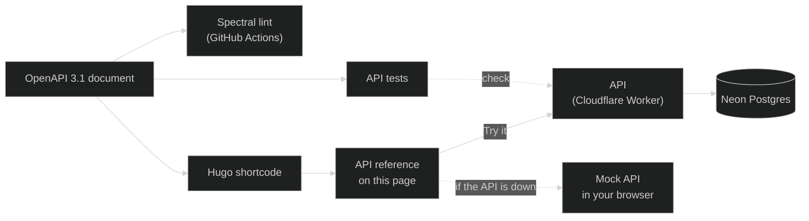
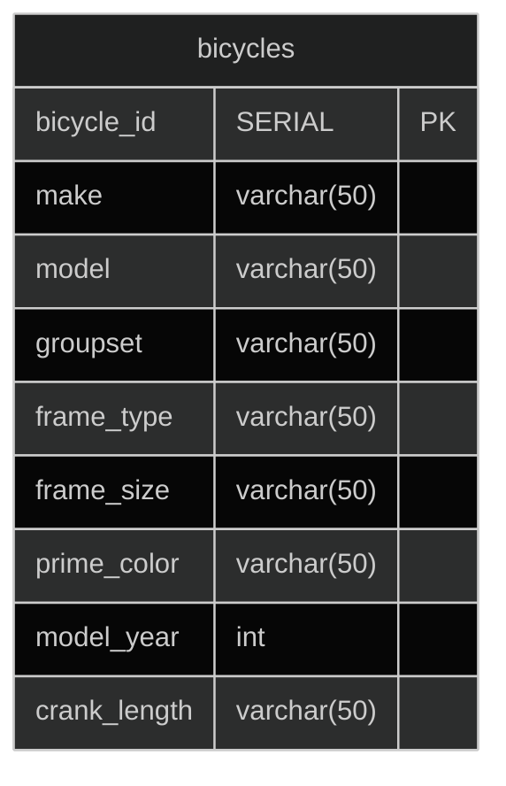

+++
title = "Bicycle Inventory API App"
hasMermaid = true
[paige.pages]
disable_authors = false
disable_date = false
disable_keywords = false
disable_next = true
disable_prev = true
disable_reading_time = true
disable_series = true
disable_toc = false
+++
## Introduction

I wanted to gain a deeper understanding of APIs and demonstrate my API documentation skills, so I set out to create a data-driven API application. I started with an idea to track all of my current and former bicycles.

Version 1 was an Express server, a hosted Postgres database, and a separate documentation site. Then the database host shut down, and the project went with it. Version 2 starts from the other end: one OpenAPI document describes the API, and this page builds the [API reference](#api-reference) from it. The API runs as a Cloudflare Worker with a Neon Postgres database. Every operation in the reference has a **Try it** form, so you can send real requests without leaving the page.

> **It's a live demo**  
> The API key is public, so you can add, update, and delete bicycles as well as read them. The inventory returns to its original four bicycles every hour. The database sleeps when nobody is using it, so the first request can take about a second.

## How this page works

- **One source.** A single file, [bicycle-inventory.yaml](https://github.com/pbj-writes/portfolio_hugo/blob/main/assets/openapi/bicycle-inventory.yaml), describes the operations, parameters, data models, examples, and errors.
- **Generated reference.** When Hugo builds the site, a [shortcode](https://github.com/pbj-writes/portfolio_hugo/blob/main/layouts/_shortcodes/openapi.html) reads that file and writes everything under [API reference](#api-reference): the headings, the tables, the code samples in three languages, and the example responses. Nothing there is typed by hand, so the reference can't disagree with the spec.
- **An API held to the spec.** The [API](https://github.com/pbj-writes/bicycle_api) is a Cloudflare Worker written in TypeScript with Hono and Zod, and it stores its data in Neon Postgres. Its tests validate every response against the same OpenAPI file, so the API can't drift from the reference without a test failing.
- **A mock as the fallback.** If the API can't be reached, a [mock](https://github.com/pbj-writes/portfolio_hugo/blob/main/assets/js/bicycle-api-mock.js) in your browser answers instead, and the result says so. The mock reads the spec too. That's how it knows which requests need an API key and which values to reject.
- **Linted on every change.** A GitHub Actions workflow checks the spec with [Spectral](https://github.com/stoplightio/spectral), including whether each example matches its schema.

## API reference

{}

## Database

One table holds the inventory.

### SQL


-- create the bicycles table with a few bicycle attributes.
CREATE TABLE bicycles (
    bicycle_id	SERIAL PRIMARY KEY,
    make varchar(50),
    model varchar(50),
    groupset varchar(50),
    frame_type varchar(50),
    frame_size varchar(50),
    prime_color varchar(50),
    model_year int,
    crank_length varchar(50)
);

-- add the four road bikes that I've ever owned.
INSERT INTO bicycles (make, model, groupset, frame_type, frame_size, prime_color, model_year, crank_length)
VALUES
('Specialized', 'Sequoia Sport', 'Shimano Sora', 'aluminum', '60cm', 'silver', '2003', '175mm'),
('Cannondale', 'CAAD8', 'Shimano Tiagra', 'aluminum', '58cm', 'white', '2014', '172.5mm'),
('Cannondale', 'CAAD13 Disc Rival AXS', 'Rival eTAP', 'aluminum', '58cm', 'purple', '2021', '175mm'),
('Cannondale', 'Topstone 4', 'microSHIFT Advent 10', 'aluminum', 'large', 'alpine', '2021', '175mm');


## Version 1 retrospective

### What I built

I'm not a developer, so finding how to write some basic APIs was intimidating. After some next-level internet searching, I found a [step-by-step guide](https://dev.to/fredabod/a-step-by-step-guide-to-using-elephantsql-with-nodejs-and-express-2e9f) for using ElephantSQL with Node.js and Express, and I built version 1 with these tools:

- **Database:** a free Postgres instance hosted by [ElephantSQL](https://elephantsql.com).
- **API server:** Node.js and Express.
- **API docs:** a [Slate](https://github.com/slatedocs/slate) site on its own subdomain.
- **IDE:** [Visual Studio Code](https://code.visualstudio.com).
- **API platform:** [Postman](https://www.postman.com).



### What went wrong

- **The database disappeared.** ElephantSQL announced its [end of life](https://www.elephantsql.com/blog/end-of-life-announcement.html) and shut down. The server ran on my computer and I never deployed it, so the demo video was the only way to see the API work. After the shutdown, the video was all that was left.
- **The docs drifted from the code.** I wrote the reference by hand, and rereading it turned up mistakes. The section on updating a bicycle said that it deletes one. The path for adding a bicycle included an ID that the server doesn't accept. The example responses weren't valid JSON.
- **The samples couldn't run.** They called a client library that I never wrote, and they sent an API key to an API that didn't check for one.
- **The server had rough edges.** It returned the bicycle count as a string, it had no way to fetch one bicycle, and its database connection string lived in the source code instead of an environment variable.

### What version 2 changes

| | Version 1 | Version 2 |
| --- | --- | --- |
| Source of the docs | Markdown written by hand | An OpenAPI 3.1 document |
| Where the docs live | A separate Slate site | This page, generated by Hugo |
| Trying the API | A demo video | A **Try it** form on every operation |
| Checking the docs | Rereading | Spectral lint on every change |
| Reading data | List every bicycle | List with filtering, sorting, and paging, or get one bicycle |
| Authentication | None | An API key for requests that change data |
| Errors | An `error` string | Problem details with a message for each invalid field |
| Server | Express, on my computer only | A Cloudflare Worker with Neon Postgres, deployed |
